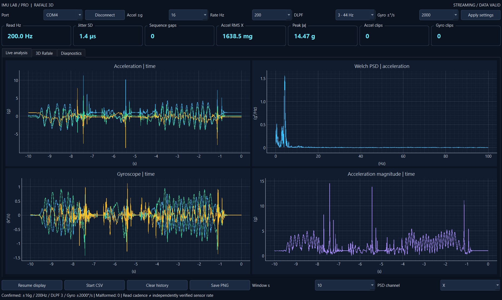
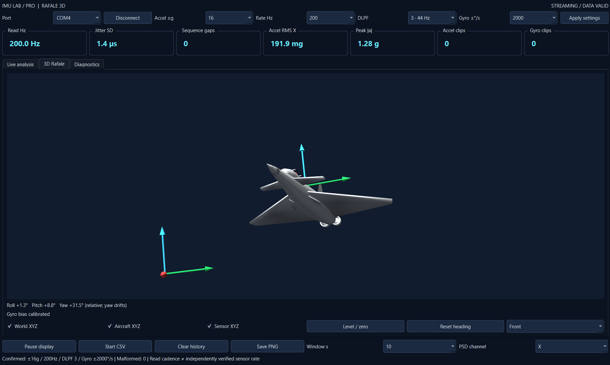

# IMU LAB Pro

IMU LAB Pro is my personal side project for experimenting with
real-time sensor acquisition, vibration signals, engineering analysis, and 3D
visualization in Python.

The current setup uses an ESP32-S3 and MPU6050 over USB serial. It is an
experimental work in progress rather than a production measurement system.

## Current features

- Live accelerometer and gyroscope plots
- Configurable sensor ranges, sample cadence, and digital filtering
- FFT/PSD-style frequency analysis
- CSV recording and basic acquisition diagnostics
- IMU orientation estimation and mounting-axis configuration
- Optional 3D Rafale orientation demonstration

The aircraft view is only a sensor-fusion visualization experiment. It is not
intended to represent a validated aircraft model or simulation.

## Project experiments

- [Structural Vibration Lab](projects/structural_vibration_lab/) — organizing
  repeatable structural-dynamics experiments, beginning with a cantilever beam.
- [Rafale orientation](projects/rafale_orientation/) — IMU sensor-fusion and
  interactive 3D orientation demonstration.
- [Physics Arcade](projects/physics_arcade/) — small physical-interface games,
  beginning with the IMU tilt-and-thrust controlled Rafale Rush.

## Screenshots

### Live signal analysis



### 3D orientation demonstration



### Rafale Rush


## Installation

Python 3.10 or newer is recommended.

```powershell
py -m venv .venv
.venv\Scripts\python.exe -m pip install --upgrade pip
.venv\Scripts\python.exe -m pip install -e ".[dev]"
```

Install the optional 3D dependencies with:

```powershell
.venv\Scripts\python.exe -m pip install -e ".[3d,dev]"
```

## Firmware

The Arduino sketch is located at:

```text
firmware/esp32_s3_mpu6050/esp32_s3_mpu6050.ino
```

Default wiring:

| MPU6050 | ESP32-S3 |
|---|---|
| VCC | 3V3 |
| GND | GND |
| SDA | GPIO5 |
| SCL | GPIO4 |

## Run

Close the Arduino Serial Monitor before connecting.

```powershell
.venv\Scripts\python.exe -m imu_lab_pro --port COM4
```

Replace `COM4` with the correct serial port.

For the optional Rafale view:

```powershell
.venv\Scripts\python.exe projects\rafale_orientation\dashboard.py --port COM4
```

For the IMU-controlled Rafale Rush game:

```powershell
.venv\Scripts\python.exe projects\physics_arcade\games\001_rafale_rush\game.py --port COM4
```

Keep the sensor stationary for a few seconds after connecting so the initial
gyroscope bias can be estimated.

## Tests

```powershell
.venv\Scripts\python.exe -m pytest
```

## Notes

- Local measurement captures are excluded from Git.
- Sensor output still contains real-world noise, bias, mounting error, and
  hardware limitations.
- Results should not be treated as calibrated engineering measurements unless
  the relevant validation procedure has been completed.
- Hardware-dependent behavior may differ from software-only tests.

This repository is mainly a place for incremental experiments and personal
engineering practice.
